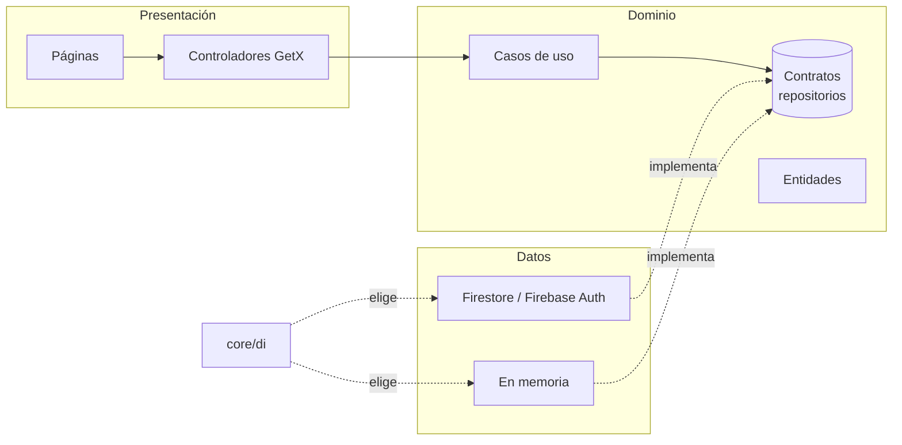

# 🏋️ GymTrack

> App para registrar tus entrenamientos y ver tu progreso en el gym. Funciona sin señal, en Android, iPhone (como app web instalable) y escritorio.


**App:** https://gymtrack-7d27c.web.app · **Diseño:** [Figma](https://www.figma.com/design/sMak9OBfPfxPM9bnshsOhh)

---

## Contenido

1. [Qué hace](#qué-hace)
2. [Tecnologías](#tecnologías)
3. [Arquitectura](#arquitectura)
4. [Estructura del proyecto](#estructura-del-proyecto)
5. [Modelo de datos](#modelo-de-datos)
6. [Cómo correrla](#cómo-correrla)
7. [Pruebas](#pruebas)
8. [Publicar (PWA)](#publicar-pwa)
9. [Cómo extenderla](#cómo-extenderla)
10. [Hoja de ruta](#hoja-de-ruta)

---

## Qué hace

### 🏠 Inicio
- El entrenamiento que toca hoy, con un botón para empezarlo.
- Métricas: **racha** de días seguidos, **entrenos de la semana** frente a tu meta y **volumen** levantado.
- La semana de un vistazo (días entrenados, hoy, próximos) y tu último entrenamiento.

### 💪 Entrenar
- Eliges una rutina (la de hoy aparece primero) y arranca un **cronómetro**.
- Tabla de series con **lo que hiciste la vez anterior**. Si marcas ✓ con los campos vacíos, usa esos valores.
- **Descanso automático** al marcar cada serie (±15 s o saltar) y vibración al terminar (en Android).
- Al finalizar: resumen con duración, series, volumen y **récords personales** nuevos.
- La sesión sigue activa aunque cambies de pestaña.

### 📈 Progresión automática y coach
- Cada ejercicio muestra **qué hacer hoy** ("Hoy: 72.5 kg × 8") con su motivo, usando **progresión doble**:
  todas las series en el tope del rango → sube el peso; si no → mismo peso y una repetición más;
  dos sesiones por debajo del mínimo → baja ~10 %. Si dejas los campos vacíos y marcas ✓, se usa ese objetivo.
- Al terminar, el **coach** comenta la sesión y muestra **qué subir la próxima vez**.
  Por defecto es un coach local (reglas, sin internet); opcionalmente usa **IA** (ver abajo).

### 📋 Rutinas
- **Arma la tuya:** nombre, días, ejercicios de un catálogo de ~50 (o personalizados), series × repeticiones y descanso. Se reordenan arrastrando.
- **Recomiéndame:** 7 preguntas (sexo, enfoque, objetivo, días, experiencia, equipo, tiempo) y genera un plan semanal completo.

| Días por semana | División |
|---|---|
| 2–3 | Cuerpo completo (A/B/C) |
| 4 | Torso / Pierna |
| 5–6 | Empuje / Tirón / Pierna |

Los ejercicios se eligen según tu equipo (gimnasio, mancuernas o sin equipo) y el volumen según tu objetivo y experiencia.

**Enfoque y sexo:** los principios de entrenamiento son los mismos para todos. El enfoque (*Equilibrado*, *Glúteos y piernas* o *Torso y brazos*) agrega un ejercicio extra de esa zona en cada día y la prioriza. Si indicas mujer, se sugiere *Glúteos y piernas* (editable) y los descansos son ~15 s más cortos, porque en promedio la recuperación entre series es más rápida.

### 🖼️ Biblioteca de ejercicios con fotos
- **~555 ejercicios en español** para armar rutinas: ~55 curados (los que usa el recomendador) + ~500 de [free-exercise-db](https://github.com/yuhonas/free-exercise-db), filtrables por músculo y con buscador.
- Cada ejercicio muestra su **foto**. Tocándola se abre **"Cómo se hace"** con la posición inicial y la final.
- Las fotos se guardan al verlas, así que después también se ven sin señal.

### 📈 Progreso
- Vista por **semana, mes o año**.
- Curva de **peso corporal** y botón para registrarlo.
- **Volumen** por día, semana o mes, con % de cambio frente al periodo anterior.
- **Récords personales** por ejercicio.

### 👤 Perfil
- Nombre, objetivo, altura y meta semanal (editables).
- **Medidas corporales** (pecho, brazo, cintura, cadera, muslo) con su cambio: verde si mejora, naranja si empeora y azul cuando depende de tu objetivo (cadera, muslo).
- **Sexo** (Hombre / Mujer / Prefiero no decir): solo para sugerir el enfoque y los descansos.
- Mis rutinas y cerrar sesión.

### 🔐 Cuenta y modo sin conexión
- Registro e inicio de sesión con correo y recuperación de contraseña.
- Cada usuario solo ve sus datos (reglas de Firestore).
- **Funciona sin señal**: los datos se guardan en el teléfono y se sincronizan al volver la conexión. El service worker permite abrir la app web offline.

---

## Tecnologías

| Capa | Tecnología |
|---|---|
| App | Flutter 3.35 · Dart 3.9 |
| Estado y dependencias | GetX |
| Autenticación | Firebase Auth (correo y contraseña) |
| Base de datos | Cloud Firestore con caché sin conexión |
| Hosting | Firebase Hosting (PWA) |
| Gráficas | `CustomPaint` propio (sin librerías) |
| Tipografía | Inter (`google_fonts`) |

---

## Arquitectura

**Clean Architecture** en tres capas. El dominio no conoce Flutter ni Firebase, así que el backend se puede cambiar sin tocar pantallas ni lógica.



### Principio Open/Closed en la práctica

| Si quieres… | Haces… | No tocas… |
|---|---|---|
| Cambiar Firebase por tu API (NestJS + Postgres) | Clases `Api…Repository` que implementen los contratos + un `case` en `core/di` | Pantallas, controladores, casos de uso |
| Nueva tarjeta en Inicio | Clase que extienda `ProgressMetric` | `GetHomeSummary`, `HomePage` |
| Nueva medida corporal (muslo…) | Una línea en `kMeasurementTypes` | Formulario, lista, cálculos |
| Nueva división de rutina | Clase que extienda `SplitTemplate` | `RoutineRecommender` |
| Otro proveedor de IA para el coach | Implementación de `AiCoach` (o cambiar la Cloud Function) | Pantalla de resultado |
| Nuevo ejercicio en el catálogo curado | Una línea en `kExerciseCatalog` | Selector y recomendador |
| Biblioteca desde Firestore o una API | Otra implementación de `ExerciseLibraryRepository` | Selector, editor de rutinas |

Además, los contratos de **lectura y escritura están separados** (`ProfileRepository` / `ProfileWriteRepository`). Así, quien solo lee no depende de algo que no usa.

### Sesión

`AuthGate` decide qué mostrar: carga, login o la app. Al iniciar sesión, `SessionBinding` crea los controladores con el **uid** del usuario; al cerrarla los destruye. Así nunca se mezclan datos entre cuentas.

---

## Estructura del proyecto

```
lib/
├── main.dart
├── firebase_options.dart          # generado por flutterfire configure
├── core/
│   ├── di/                        # ÚNICO lugar donde se elige la implementación
│   └── theme/                     # colores y estilos (tokens del diseño en Figma)
├── domain/                        # Dart puro
│   ├── entities/                  # Exercise, Routine, WorkoutSession, UserProfile…
│   ├── repositories/              # contratos (WorkoutRepository, AuthRepository…)
│   ├── catalog/                   # catálogo de ejercicios y rutinas de ejemplo
│   ├── metrics/                   # métricas de Inicio
│   ├── usecases/                  # resumen de Inicio, entrenar, progreso,
│   │                              # perfil, cuenta y recomendador de rutinas
│   └── utils/                     # fechas y formatos
├── data/
│   ├── mappers/                   # entidad ↔ Map (sirve para Firestore o REST)
│   └── repositories/              # Firestore, Firebase Auth y en memoria
└── presentation/
    ├── auth/                      # login, registro, AuthGate
    ├── shell/                     # barra inferior y SessionBinding
    ├── home/  workout/  progress/  profile/  routines/
    └── widgets/                   # componentes compartidos
web/
├── index.html  manifest.json      # PWA: nombre, íconos, iOS
├── gymtrack_sw.js                 # service worker (abrir sin señal)
└── icons/
test/                              # pruebas de dominio, controladores y widgets
firestore.rules                    # seguridad: cada usuario solo accede a lo suyo
firebase.json · .firebaserc        # Hosting, reglas y emuladores
deploy.ps1                         # compilar y publicar en un paso
```

---

## Modelo de datos

Todo vive bajo el uid del usuario en Firestore:

```
users/{uid}                       name, goal, weeklyGoal, heightCm, sex
├── routines/{id}                 name, focus, estimatedMinutes, weekdays[],
│                                 exercises[{id, name, muscleGroup, equipment,
│                                            targetSets, targetReps, restSeconds}]
├── sessions/{id}                 routineName, startedAt, finishedAt,
│                                 logs[{exercise, sets[{reps, weightKg, completed}]}]
├── body_weights/{id}             date, kg
└── measurements/{id}             date, valuesCm{chest, arm, waist, hip, thigh}
```

Es plano y con IDs explícitos, para poder llevarlo a tablas SQL sin dolor si algún día cambia el backend.

---

## Cómo correrla

### Requisitos
- Flutter 3.35+
- Para Firebase: Node.js y `firebase-tools` (`npm i -g firebase-tools`) y `flutterfire_cli` (`dart pub global activate flutterfire_cli`)
- Para los emuladores: Java JDK 21

```bash
flutter pub get
```

### Modos

| Modo | Comando | Para qué |
|---|---|---|
| **Datos de ejemplo** | `flutter run -d chrome` | Revisar pantallas rápido. Sin login ni Firebase. |
| **Emuladores locales** | Terminal 1: `firebase emulators:start --import ./emu-data --export-on-exit`<br>Terminal 2: `flutter run -d chrome --dart-define=BACKEND=firebase --dart-define=EMULATORS=true` | Probar todo (login, datos) sin tocar la nube. Panel en http://localhost:4000 |
| **Firebase real** | `flutter run -d chrome --dart-define=BACKEND=firebase` | Usar tus datos reales. |

En VS Code están las tres configuraciones en *Ejecutar y depurar* (F5).

### Configurar Firebase (una sola vez)
1. Crea el proyecto en la [consola de Firebase](https://console.firebase.google.com).
2. **Authentication** → habilita *Correo electrónico/contraseña*.
3. **Firestore Database** → crea la base en modo producción.
4. En la carpeta del proyecto:
   ```bash
   firebase login
   flutterfire configure
   ```

### Opciones de compilación

| `--dart-define` | Valores | Efecto |
|---|---|---|
| `BACKEND` | `memory` (por defecto) · `firebase` | Fuente de datos |
| `EMULATORS` | `true` · `false` (por defecto) | Usa Auth/Firestore/Functions locales |
| `AI_COACH` | `cloud` · vacío (por defecto) | Coach con IA vía Cloud Function |

---

## Pruebas

```bash
flutter test
```

Hay unas 50 pruebas que cubren:
- **Dominio:** métricas, récords, progreso por rango, medidas y el recomendador de rutinas (división, equipo, rotación, volumen).
- **Controladores:** entrenamiento, perfil, rutinas y autenticación.
- **Widgets:** Inicio, Entrenar, Progreso, Perfil y el flujo login → Inicio → cerrar sesión.

---

## Publicar (PWA)

```powershell
powershell -ExecutionPolicy Bypass -File deploy.ps1
```

Compila con Firebase y publica en **https://gymtrack-7d27c.web.app** junto con las reglas de Firestore.

**Instalarla:**
- **iPhone:** abre el enlace en **Safari** → Compartir → *Añadir a pantalla de inicio*.
- **Android:** Chrome → ⋮ → *Instalar app*.

**Actualizar:** vuelve a correr `deploy.ps1`. En el teléfono, abre la app con señal, ciérrala del todo y vuelve a abrirla.

**Probar en el iPhone sin publicar:** `firebase hosting:channel:deploy pruebas` crea una URL temporal.

---

## Cómo extenderla

**Otro backend (p. ej. NestJS + Postgres):**
1. Crea `ApiWorkoutRepository implements WorkoutRepository` (y los demás contratos) en `data/repositories/`.
2. Reutiliza los mappers de `data/mappers/` para el JSON.
3. Agrega `Backend.api` y su `case` en `core/di/dependency_injection.dart`.
4. Para el login, verifica el token de Firebase en el backend (`firebase-admin`).

**Otra métrica en Inicio:**
```dart
class TotalWorkoutsMetric extends ProgressMetric {
  @override
  String get label => 'Entrenos totales';

  @override
  MetricAccent get accent => MetricAccent.orange;

  @override
  String compute({
    required List<WorkoutSession> sessions,
    required UserProfile profile,
    required DateTime now,
  }) =>
      '${sessions.length}';
}
// y agrégala a la lista de métricas en core/di/dependency_injection.dart
```

---

## Coach con IA (opcional)

El coach es un contrato (`AiCoach`) con dos implementaciones: `LocalCoach` (reglas, por defecto) y
`CloudFunctionAiCoach`, que llama a la Cloud Function `coachWorkout` (`functions/`). La función es la
única que conoce la llave del modelo, exige sesión iniciada, limita a 20 mensajes por persona al día
y recibe solo un resumen del entrenamiento (sin nombre, correo ni ids). Si la IA falla o no hay señal,
la app usa el coach local automáticamente (`FallbackCoach`).

Activarla (una sola vez):
1. Pasa el proyecto de Firebase al plan **Blaze** (pago por uso; tiene cuota gratis).
2. Crea una llave en la consola de Anthropic y guárdala como secreto:
   `firebase functions:secrets:set ANTHROPIC_API_KEY`
3. Publica la función: `powershell -ExecutionPolicy Bypass -File deploy-functions.ps1`
4. Publica la app con IA: `powershell -ExecutionPolicy Bypass -File deploy.ps1 -Ai`

El modelo se cambia en `functions/.env` (`COACH_MODEL`). Para usar otro proveedor, cambia la llamada
en `functions/src/index.ts`; la app no se toca.

## Biblioteca de ejercicios

`assets/exercise_library.json` se genera a partir de
[free-exercise-db](https://github.com/yuhonas/free-exercise-db) (dominio
público, Unlicense): ejercicios de fuerza con equipo de gimnasio, con nombre en
español (`tool/exercise_names_es.tsv`) y músculo/equipo traducidos. Las fotos
se cargan desde el repositorio original en GitHub.

Para regenerarla (por ejemplo, tras corregir o agregar traducciones):

```bash
git clone --depth 1 https://github.com/yuhonas/free-exercise-db.git
python tool/build_exercise_library.py free-exercise-db/dist/exercises.json
```

## Hoja de ruta

- [x] Inicio, Entrenar, Progreso y Perfil
- [x] Firebase Auth + Firestore con caché sin conexión
- [x] Crear/editar rutinas y recomendación de rutina
- [x] PWA instalable en iPhone y Android
- [ ] Recordatorios (notificaciones)
- [x] Biblioteca de ~555 ejercicios con fotos
- [x] Progresión automática (doble) y coach al terminar
- [ ] Recomendador conversacional y ajustes por chat con IA
- [ ] Gráfica de progreso por ejercicio
- [ ] App nativa para iOS (TestFlight)
- [ ] Backend propio (NestJS + Postgres)

---

## Autor

**Luis Vega** — Ingeniería de Sistemas, Universidad Popular del Cesar.

Fotos y datos base de ejercicios: [free-exercise-db](https://github.com/yuhonas/free-exercise-db) (dominio público).
